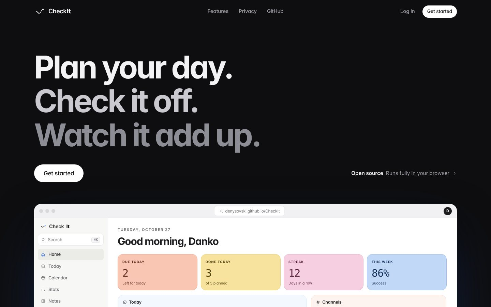
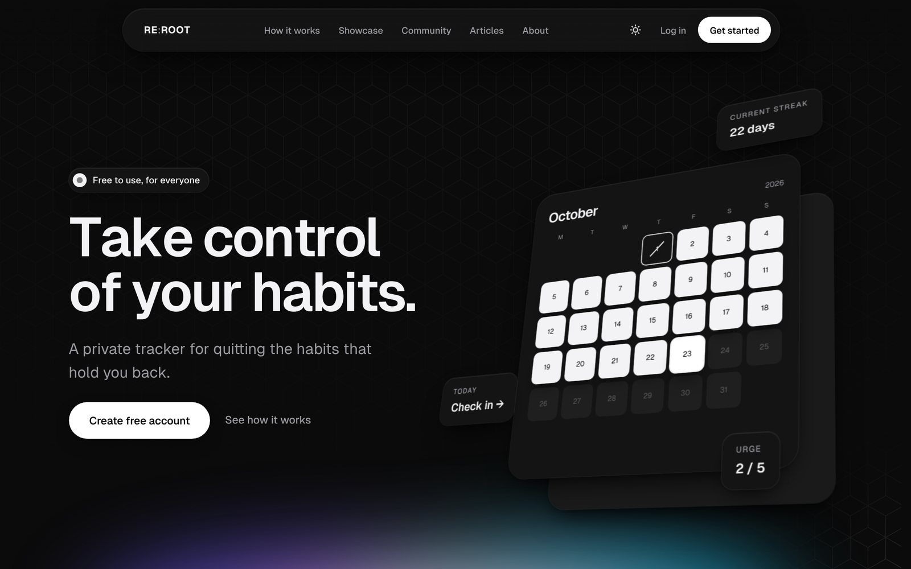

## About Me

I specialize in building modern, performance optimized websites and crafting complete brand identities from scratch.

Currently studying **Web Technologies at UPCE** while actively taking on freelance projects. I integrate Artificial Intelligence into my workflow to push the quality of design and code further than traditional methods allow.

  <a href="https://www.instagram.com/denysovski2" title="Instagram"><picture><source media="(prefers-color-scheme: dark)" srcset="assets/icons/instagram-light.svg"></picture></a>
  &nbsp;
  <a href="https://www.linkedin.com/in/denysovski/" title="LinkedIn"><picture><source media="(prefers-color-scheme: dark)" srcset="assets/icons/linkedin-light.svg"></picture></a>
  &nbsp;
  <a href="https://www.behance.net/denysovski" title="Behance"><picture><source media="(prefers-color-scheme: dark)" srcset="assets/icons/behance-light.svg"></picture></a>

## What I Do

- **Web Design** — modern UI/UX focused on minimalism and user experience
- **Frontend Development** — fast, responsive, production ready web apps
- **Brand Identity** — complete visual identity systems built from the roots
- **Graphic Design** — digital assets, visual direction, marketing materials
- **AI-Integrated Workflows** — AI at every step for smarter, faster results

## Tech Stack

- **Frontend** — React, TypeScript, JavaScript, Next.js, Vite, Tailwind CSS, GSAP, Three.js, HTML5, CSS3
- **Design** — Figma, Adobe Photoshop, Canva
- **AI & Tools** — Claude, AntiGravity, Cursor, Visual Studio Code, GitHub Copilot
- **Other** — Networking, Cybersecurity basics, Database design, UML, Technical documentation, Agile

## Latest Projects

Lately I focus on scroll-driven motion, editorial layouts, full shop and booking flows that run entirely in the browser, and SEO with structured data.

### NATURIK

One-product drop store for a limited, numbered puffer jacket. Scroll-driven photo stage, 3D objects rendered only when on screen, full shop with filters, size finder and a 4-step demo checkout.

**Vite · JavaScript · GSAP · Lenis · Three.js**

&nbsp;<a href="https://github.com/denysovski/NATURIK"><picture><source media="(prefers-color-scheme: dark)" srcset="assets/buttons/code-light.svg"></picture></a>

<table>
  <tr>
    <td width="50%" valign="top">
      
      
<b>COURTSY</b> Website and booking system for a private sport club. Memberships, court booking, events, e-shop and a validated 4-step checkout.

      
<b>React · Vite · React Router · Framer Motion</b>

      
&nbsp;<a href="https://github.com/denysovski/ModernityRay"><picture><source media="(prefers-color-scheme: dark)" srcset="assets/buttons/code-light.svg"></picture></a>

    </td>
    <td width="50%" valign="top">
      
      
<b>KONDORU</b> Editorial property and architecture site. 18 residences with detail pages, client-side search, image pipeline and a full SEO layer.

      
<b>Next.js · React · TypeScript · Tailwind CSS</b>

      
&nbsp;<a href="https://github.com/denysovski/KondoruArch"><picture><source media="(prefers-color-scheme: dark)" srcset="assets/buttons/code-light.svg"></picture></a>

    </td>
  </tr>
  <tr>
    <td width="50%" valign="top">
      
      
<b>K-DERMA</b> Brand identity, web design and development for an orthodontic clinic, with an admin dashboard for articles and schedules.

      
<b>React · TypeScript · Tailwind CSS · Express</b>

      
&nbsp;<a href="https://github.com/denysovski/KDermaDentist"><picture><source media="(prefers-color-scheme: dark)" srcset="assets/buttons/code-light.svg"></picture></a>

    </td>
    <td width="50%" valign="top">
      
      
<b>TESLA FUTURISTIC</b> Unofficial concept product page. Interactive vehicle showcase, energy ecosystem, performance panels and a test drive flow.

      
<b>React · Vite · Tailwind CSS · GSAP</b>

      
&nbsp;<a href="https://github.com/denysovski/TeslaFuturistic"><picture><source media="(prefers-color-scheme: dark)" srcset="assets/buttons/code-light.svg"></picture></a>

    </td>
  </tr>
  <tr>
    <td width="50%" valign="top">
      
      
<b>CHECK IT</b> Calm daily checklist with custom rhythms, notes, calendar, stats and export. Runs fully in the browser, no server and no tracking.

      
<b>JavaScript · GSAP · Lenis · IndexedDB · PWA</b>

      
&nbsp;<a href="https://github.com/denysovski/CheckIt"><picture><source media="(prefers-color-scheme: dark)" srcset="assets/buttons/code-light.svg"></picture></a>

    </td>
    <td width="50%" valign="top">
      
      
<b>RE:ROOT</b> Private habit tracker for quitting bad habits. Daily check-ins, streak and urge charts, diary, reminders and CSS 3D scenes.

      
<b>HTML · CSS · JavaScript · CSS 3D · PWA</b>

      
&nbsp;<a href="https://github.com/denysovski/ReRoot"><picture><source media="(prefers-color-scheme: dark)" srcset="assets/buttons/code-light.svg"></picture></a>

    </td>
  </tr>
</table>

More graphic design work on [Behance](https://www.behance.net/denysovski).

## Music and YouTube

Since 2020 I have worked as a YouTube reposter, promoting and curating music content. It sharpened my sense for trending music (Phonk at the time) and built connections with top artists in the industry.

## Instagram

For over a year my content has consistently reached 2 million views every month, with around 500,000 interactions monthly. Bold, engaging topics built to drive attention and discussion at scale, backed by a practical understanding of virality, content strategy and social media algorithms.
